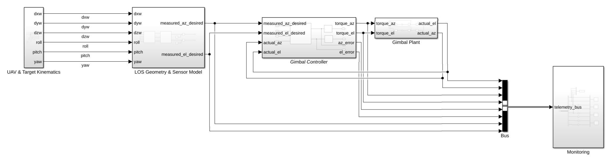

# UAV Gimbal Stabilization and Moving-Target Tracking

MATLAB/Simulink project for modeling and controlling a two-axis gimbal mounted on a moving Unmanned Aerial Vehicle (UAV).

The model computes the line of sight (LOS) from a moving UAV to a moving ground target, transforms the target direction into the UAV body frame, and controls the gimbal azimuth and elevation to maintain target tracking despite UAV attitude motion, sensor noise, actuator dynamics, and attitude disturbances.

---

## Overview

The simulation includes:

- Moving UAV and ground-target trajectories
- Time-varying UAV roll, pitch, and yaw
- World-to-body coordinate transformation
- LOS azimuth and elevation calculation
- Angular measurement noise
- Independent azimuth and elevation PID controllers
- Two-axis rotational gimbal dynamics
- Torque, angular-rate, and angular-position constraints
- Tracking-error monitoring
- 3D visualization of the simulated system

---

## Simulink Model

The simulation can be divided conceptually into four stages:

1. **UAV and target kinematics**
2. **LOS geometry and sensor model**
3. **Gimbal control**
4. **Gimbal monitoring**



### UAV and target kinematics

The UAV and target positions are generated as functions of time.

The relative target position in world coordinates is

$$
\mathbf{r}_W = \mathbf{p}_T - \mathbf{p}_U
$$

where $\mathbf{p}_U$ and $\mathbf{p}_T$ are the UAV and target positions, respectively.

The UAV attitude is represented by roll $\phi$, pitch $\theta$, and yaw $\psi$.

### World-to-body transformation

The relative target vector is transformed from world coordinates into the UAV body frame using

$$
\mathbf{r}_B = R^T \mathbf{r}_W
$$

with the body-to-world rotation matrix

$$
R = R_z(\psi)R_y(\theta)R_x(\phi)
$$

The body coordinate convention used in the model is:

- +x: forward
- +y: left
- +z: upward

Zero gimbal azimuth and elevation therefore correspond to a camera boresight aligned with the UAV +x body axis.

---

### Line-of-sight angles

The desired gimbal angles are calculated from the target vector expressed in body coordinates:

$$
\mathrm{az}_{\mathrm{des}} =
\mathrm{atan2}(y_B,x_B)
$$

and

$$
\mathrm{el}_{\mathrm{des}} =
\mathrm{atan2}\left(z_B,\sqrt{x_B^2+y_B^2}\right)
$$

Angular measurement noise is added to the desired LOS angles before they are supplied to the controller.

---

### Gimbal controller

Independent PID controllers are used for the azimuth and elevation axes. Each controller computes the commanded torque from the angular tracking error $e(t)$ between the measured desired line-of-sight (LOS) direction and the actual gimbal orientation.

The ideal PID control law is given by

$$
\tau_{\mathrm{cmd}}(t) = K_p e(t) + K_i \int_0^t e(t')\,dt' + K_d \frac{de(t)}{dt}
$$

where:

- $K_p$: proportional gain, which determines the response to the instantaneous tracking error.
- $K_i$: integral gain, which compensates for persistent tracking errors by accumulating the error over time.
- $K_d$: derivative gain, which accounts for the rate of change of the tracking error, providing damping and reducing overshoot.
- $N$: derivative filter coefficient, which controls the attenuation of high-frequency measurement noise.

**Derivative filtering**

Since differentiation amplifies high-frequency measurement noise, a first-order low-pass filter is applied to the derivative term to prevent undesirable torque fluctuations. In the Laplace domain, the ideal derivative transfer function $K_d s$ is replaced by

$$
D(s) = K_d s \frac{N}{s+N}
$$

where $s$ is the Laplace variable and $N/(s+N)$ is the low-pass filter transfer function, characterised by a time constant and cutoff frequency given by

$$
T_f = \frac{1}{N}, \qquad f_c = \frac{N}{2\pi}
$$

Below the cutoff frequency, the derivative term approximates an ideal differentiator, while at higher frequencies the filter limits noise amplification. Smaller values of $N$ provide stronger noise attenuation but a slower derivative response, whereas larger values provide a faster response at the expense of increased noise sensitivity.

In the current model, $N = 100$ for both axes, corresponding to a time constant of 0.01 s and a cutoff frequency of approximately 15.9 Hz.

**Controller parameters**

| Axis | Kp | Ki | Kd | N |
|---|---:|---:|---:|---:|
| Azimuth | 2.0 | 0.5 | 0.20 | 100 |
| Elevation | 1.8 | 0.4 | 0.18 | 100 |

**Back-calculation anti-windup**

Back-calculation anti-windup is enabled with `Kb = 1` to prevent excessive accumulation of the integral term during actuator saturation.

In the ideal PID formulation, assuming zero initial integral contribution,

$$
I(t) = K_i \int_0^t e(t')\,dt'
$$

and therefore

$$
\frac{dI(t)}{dt} = K_i e(t)
$$

When the commanded torque exceeds the physical actuator limits, the integral term may continue accumulating error without producing additional actuator torque. This phenomenon, known as integral windup, can cause overshoot and slow controller recovery.

To mitigate this effect, back-calculation modifies the evolution of the integral contribution according to

$$
\frac{dI(t)}{dt} = K_i e(t) + K_b \left(\tau_{\mathrm{sat}}(t) - \tau_{\mathrm{cmd}}(t)\right)
$$

where:

- $\tau_{\mathrm{cmd}}$: torque requested by the PID controller before saturation.
- $\tau_{\mathrm{sat}}$: torque after applying the physical actuator limits.
- $K_b$: back-calculation gain, which determines the strength of the correction.

The difference between the saturated and commanded torques provides a feedback correction that counteracts integral windup, reducing overshoot and improving recovery after saturation. When no saturation occurs, both torques are equal, the correction vanishes, and standard PID integration is recovered.

---

### Gimbal dynamics

Each gimbal axis is modeled using the rotational equation

$$
J\ddot{\theta} + b\dot{\theta} = \tau
$$

where:

- $J$ is the rotational inertia
- $b$ is the damping coefficient
- $\theta$ is the gimbal angle
- $\tau$ is the applied torque

The current model parameters are:

| Parameter | Azimuth | Elevation |
|---|---:|---:|
| Inertia J | 0.035 | 0.025 |
| Damping b | 0.06 | 0.05 |
| Maximum torque | ±1.5 N m | ±1.5 N m |
| Maximum angular rate | ±120 deg/s | ±120 deg/s |
| Angular range | Continuous | -90 to +30 deg |

---

## Disturbances and sensor noise

The UAV trajectory contains time-varying position and attitude components, requiring the gimbal to continuously adapt its orientation to maintain the target within the camera line of sight.

Additional attitude disturbances are introduced during the simulation to examine the transient response of the tracking controller.

Angular measurement noise is also included in the LOS measurements.

Together, these effects provide a simple test environment for evaluating the tracking response under changing operating conditions.

---

## 3D Visualization

A MATLAB script reconstructs the simulation using data exported from Simulink and generates a 3D visualization of the tracking problem.

The visualization displays:

- UAV position and attitude
- Moving ground target
- Recent UAV and target trajectories
- UAV body coordinate axes
- True target LOS
- Actual camera boresight
- Camera field-of-view cone
- Gimbal azimuth and elevation
- Control torques
- True 3D pointing error

The true 3D pointing error is calculated from the angle between the LOS unit vector and camera boresight:

$$
\epsilon =
\cos^{-1}\left(
\mathbf{u}_{\mathrm{LOS}} \cdot
\mathbf{u}_{\mathrm{cam}}
\right)
$$

The field-of-view cone is intended as a visualization aid and it does not correspond to a model.

---

## Repository structure

```text
uav-gimbal-tracking-simulink/
│
├── README.md
├── LICENSE
│
├── model/
│   └── UAV_Gimbal_Stabilization_and_Moving_Target_Tracking.slx
│
├── animation_script/
│   ├── animate_gimbal_tracking.m
│
├── media/
│   ├── uav_gimbal_tracking.gif
│   ├── model_overview.png

```
---

## Running the project

1. Clone or download the repository.

2. Open the Simulink model:

   `model/UAV_Gimbal_Stabilization_and_Moving_Target_Tracking.slx`

3. Run the Simulink simulation.

4. Run:

   `scripts/animate_gimbal_tracking.m`

   to generate the 3D visualization and animated GIF.

---

## Results

Simulation results can be explored directly in Simulink through the
diagnostic scopes included in the **Monitoring** subsystem. These scopes
allow the desired and actual azimuth and elevation angles, as well as the
corresponding tracking errors, to be inspected throughout the simulation.


---

## Author

**Santiago Hernández Díaz**

PhD candidate in Physics
University of Tübingen


